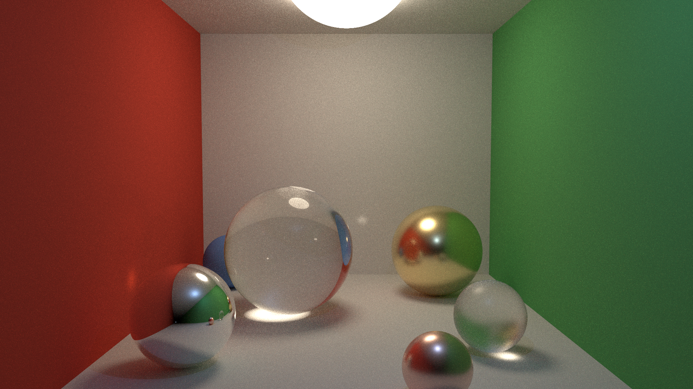

# Albedo

A physically based path tracer in C++20. Done with AI.



The image above is what the `albedo` app renders from
[`assets/showcase.scene`](assets/showcase.scene): 1920 × 1080 pixels at 256 samples per pixel. It
uses most of what the renderer can do:

- **Path tracing** with next-event estimation and multiple importance sampling (power heuristic),
  plus Russian roulette.
- **Lights:** a spherical area light in the ceiling (soft shadows), a point light (hard shadows)
  and a faint sky.
- **Materials:**
  - diffuse walls, whose red and green bleed onto the floor and spheres;
  - smooth glass, which focuses light into a caustic on the floor;
  - frosted glass, using rough GGX transmission;
  - a silver mirror;
  - rough gold and copper, with GGX microfacets and complex refractive indices measured by
    Johnson and Christy (1972).
- **Rendering:** stratified, jittered pixel sampling and multithreaded tile rendering, with
  images identical for any thread count.

The walls are very large spheres (the meshes scene below has a two-triangle floor). The renderer
also traces triangle meshes read from Wavefront OBJ files, found quickly through a bounding volume
hierarchy, places one mesh many times through transformed instances, and colors surfaces with
textures. Scenes are described in a small text format (see [Rendering](#rendering)). The
[roadmap](doc/roadmap.md) lists every step and the literature each part follows.

Earlier milestones are kept in [`scenes/`](scenes).

## Building

Requirements:

- CMake 3.24 or newer.
- A C++20 compiler whose standard library provides `std::format`, such as GCC 13 or newer.

The build is tested on Linux with GCC 13. The CMake setup also has MSVC flags (`/W4 /WX`), but
no Windows build has been run.

For rendering, use an optimized build:

```bash
cmake -S . -B build-release -DCMAKE_BUILD_TYPE=Release -DALBEDO_BUILD_TESTS=OFF
cmake --build build-release --config Release -j
```

`--config` matters only for multi-configuration generators such as Visual Studio, which ignore
`CMAKE_BUILD_TYPE` and place the executable in a per-configuration directory
(`build-release/apps/Release/`).

If your default compiler is older, choose one explicitly, for example
`-DCMAKE_CXX_COMPILER=g++-13`.

## Rendering

```bash
./build-release/apps/albedo assets/showcase.scene out.ppm 1920
```

The first argument is a scene file, the second the output: a binary PPM image. The width (16 to
8192 pixels, default 960) sets the size, and the height follows from the 16:9 aspect ratio. Many
image viewers open PPM directly; to get a PNG, use any converter, for example ImageMagick's
`magick out.ppm out.png`. The app uses every hardware thread; on an 8-thread machine the
1920-pixel showcase takes about four minutes.

[`assets/meshes.scene`](assets/meshes.scene) shows the sample trefoil knot three times, in gold,
glass and copper, each scaled, turned and stood on a checkered floor, as in
[`scenes/step-09-textures-instancing.png`](scenes/step-09-textures-instancing.png). The copies
are instances: they share one set of triangles and one bounding volume hierarchy, each placed by
its own transform. The blue sphere is checkered too, in latitude and longitude. The knot is
generated by [`assets/generate_trefoil_knot.py`](assets/generate_trefoil_knot.py); its
1920-pixel render takes about nine minutes on an 8-thread machine.

### Scene files

A scene file has one statement per line: a keyword followed by fields, named and in any order.
`#` starts a comment.

```
camera from 0 2.4 7.8  at 0 1.9 -0.5  fov 38
sky 0.05 0.06 0.08

material gold  conductor eta 0.156 0.424 1.383  k 3.602 2.472 1.915  roughness 0.25
material tiles checker even 0.73 0.73 0.73  odd 0.3 0.3 0.3  frequency 1.25

sphere 1.6 0.8 -2.2  radius 0.8  material gold
point_light 0.8 4.2 3.2  intensity 1.2 2 3.6
area_light 0 5.6 -1.2  radius 1.1  radiance 9 7.6 5.8

mesh knot trefoil_knot.obj
instance knot material gold  fit 2.6  rotate 0 1 0 20  ground  translate 0.1 0 -2.3
```

Materials are `diffuse`, `checker`, `perlin` (solid noise between two colors, cloudy or with
marble `veins`), `conductor` and `dielectric`. An `instance` places a mesh with
operations applied in the order written: `translate`, `scale`, `rotate`, `fit` (scale to a size)
and `ground` (stand on y = 0). The full grammar and the range each value must lie in are
documented on `readScene` in
[`src/albedo/scene/scene_file.hpp`](src/albedo/scene/scene_file.hpp).

Scene files are treated as untrusted input. The reader bounds line lengths, object and material
counts, mesh sizes and the work of `ground`, rejects values the renderer could not handle, and
reports the first problem it finds, with its line number where there is one. A `mesh` may only name
a regular file inside the scene's own directory: absolute paths, `..`, links leading out and Windows
device names are rejected. The OBJ reader uses vertex positions, texture coordinates and faces,
splitting polygons into triangles, and ignores everything else, including normals and materials, so
coarse meshes look faceted.

## Tests

Debug builds compile with AddressSanitizer and UndefinedBehaviorSanitizer by default (only
AddressSanitizer on MSVC; turn them off with `-DALBEDO_ENABLE_SANITIZERS=OFF`). All warnings are
errors. The tests use GoogleTest, which is downloaded when the build is first configured, so that
step needs network access.

```bash
cmake -S . -B build -DCMAKE_BUILD_TYPE=Debug
cmake --build build --config Debug -j
ctest --test-dir build -C Debug --output-on-failure
```

## License

GNU General Public License v3.0; see [LICENSE](LICENSE).
